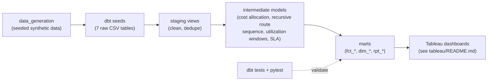

# field-ops-sql-cost-audit

A dbt + SQL project that reconciles messy field-operations data into a true cost-to-serve per job and shows where SLA breaches concentrate.

[](https://github.com/SlateGitOrg/field-ops-sql-cost-audit/actions/workflows/ci.yml)

## Why

Field-service and delivery operators need two answers they rarely get: what does it really cost to serve each job, and where do SLA breaches actually happen? The data that answers both sits in separate operational systems (dispatch, routes, timesheets, parts billing) with duplicate rows, orphaned references and credit lines. This project models those tables through a tested dbt pipeline into reporting views, with the hard SQL (recursive route sequencing, utilization windows, cost allocation) written once and covered by tests.

## Features

- Staging models that dedupe double-logged timesheets and roster rows and normalise every raw table.
- Per-job cost-to-serve: labor + net parts billing (credits netted) + travel overhead, floored at zero.
- Recursive CTE that walks each route's `prev_stop_id` linked list to get stop order, leg travel time and cumulative distance.
- Weekly technician utilization with a trailing 4-week rolling average (window functions).
- Job-level SLA breach flags and a region / priority / month breach summary.
- A data-quality exceptions view for jobs whose technician can't be resolved, so excluded jobs stay visible instead of silently disappearing.
- Runs fully offline on DuckDB against a deterministic synthetic dataset; the same SQL targets PostgreSQL via the `prod` profile.

## Architecture



Raw tables land as dbt seeds in DuckDB, then flow through three layers: `staging` (views), `intermediate` (views) and `marts` (tables). The SQL sticks to the ANSI/Postgres-compatible subset, so the models are unchanged between the `dev` (DuckDB) and `prod` (PostgreSQL) targets.

## Quick start

Prerequisites: Python 3.11+. No warehouse or credentials needed.

```bash
python3 -m venv .venv && source .venv/bin/activate
pip install -r requirements.txt

# 1. Generate the synthetic dataset into dbt_project/seeds/
python data_generation/generate_data.py

# 2. Seed, build and test all models (DuckDB)
export DBT_PROFILES_DIR=$PWD/dbt_project
cd dbt_project && dbt build --target dev && cd ..

# 3. Run the pytest suite
python -m pytest tests/ -v
```

`dbt build` creates `dbt_project/target/field_ops_cost_audit.duckdb`. A Dockerfile runs the same three steps in one container.

## Example

Query the built database for the SLA breach rate by region and priority:

```bash
python - <<'PY'
import duckdb
con = duckdb.connect("dbt_project/target/field_ops_cost_audit.duckdb", read_only=True)
print(con.sql("""
    select region, priority, sum(breached_jobs) as breached, sum(total_jobs) as jobs
    from main_marts.fct_sla_breach_summary
    group by 1, 2 having sum(breached_jobs) > 0 order by 1, 2
"""))
PY
```

Output on the default seed (trimmed to rows with breaches):

| region | priority  | breached | jobs |
|--------|-----------|---------:|-----:|
| East   | Emergency |        1 |    9 |
| East   | Rush      |        2 |   26 |
| East   | Standard  |       18 |   77 |
| South  | Emergency |        1 |   10 |
| South  | Rush      |        7 |   44 |
| South  | Standard  |       15 |  104 |

Central, North and West have no breaches. That is by construction of the synthetic data (East and South are modelled as understaffed), and it is the pattern the SLA dashboard is meant to surface.

## How it works

| Layer | Models | What they do |
|---|---|---|
| Staging | `stg_jobs`, `stg_technicians`, `stg_timesheets`, `stg_route_stops`, `stg_parts_billing`, `stg_sla_targets` | Type, clean and dedupe the raw tables |
| Intermediate | `int_route_sequence`, `int_job_travel_minutes`, `int_job_labor_cost`, `int_job_parts_cost`, `int_job_technician_link`, `int_job_cost_to_serve`, `int_technician_utilization`, `int_sla_breach` | Recursive route walk, cost components, technician resolution, utilization windows, SLA logic |
| Marts | `fct_job_cost_to_serve`, `fct_technician_utilization`, `fct_job_sla_breach`, `fct_sla_breach_summary`, `dim_technicians`, `rpt_data_quality_exceptions` | Reporting views and tables for BI |

Design notes:

- **Route sequencing.** Dispatch systems hand over stops as a linked list. `int_route_sequence` anchors on stops with a null `prev_stop_id` and recurses, measuring each leg from the previous stop's departure to this stop's arrival.
- **Cost-to-serve** is labor + net parts + travel minutes at the technician's hourly rate. Jobs with an unresolvable technician are excluded rather than costed with a guessed rate; they appear in `rpt_data_quality_exceptions`. The total is floored at 0 so a credit-only job never reports negative cost.
- **SLA breach** is `completed_at > created_at + target_resolution_hours`, independent of technician resolution, so orphaned jobs still have a defined outcome.
- **Utilization** assumes a 40-hour standard week; billable hours are timesheet entries of type `job`.
- **Independent check.** The generator derives a 20-job SLA sample in a separate Python code path (`sla_hand_verified_sample.csv`), and a dbt test asserts the SQL agrees with it.

## Testing

`dbt build` runs 70 nodes (7 seeds, 14 views, 6 tables, 43 data tests): uniqueness, not-null, relationships, plus singular tests for no negative costs, no orphaned jobs in cost-to-serve, no cycles in route sequences and agreement with the hand-verified SLA sample.

`pytest tests/` (19 tests, about 30 s) covers data-generation determinism and the deliberate data defects, recursive route sequencing and SLA logic on small in-memory DuckDB fixtures, and an end-to-end dbt build with assertions on the marts. GitHub Actions runs the same steps on every push and pull request.

## Project layout

```
data_generation/     seeded synthetic data generator
dbt_project/
  models/{staging,intermediate,marts}/
  seeds/             generated raw CSVs
  tests/             singular dbt tests
  profiles.yml       dev (DuckDB) and prod (PostgreSQL) targets
tableau/             dashboard specifications
tests/               pytest suite
Dockerfile           one-container build + test
```

## Running against PostgreSQL

The `prod` target reads `PGHOST`, `PGPORT`, `PGUSER`, `PGPASSWORD`, `PGDATABASE` and `PGSCHEMA`. It needs the `dbt-postgres` adapter, which is not in `requirements.txt`, and is not exercised by CI.

```bash
pip install dbt-postgres
cd dbt_project && dbt build --target prod
```

## Limitations

- The data is synthetic; cost rates, SLA targets and the East/South staffing effect are modelled assumptions, not real operations data.
- The `prod` PostgreSQL target is configured but untested here.
- The Tableau dashboards are specified in `tableau/README.md`; no workbook file is included.

## License

MIT — see [LICENSE](LICENSE).
